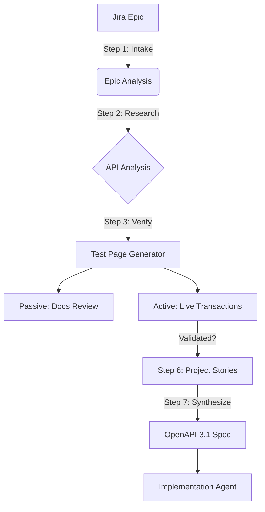

# PRD Assistant - Agentic Payment Integration Workflow

> **From Jira Ticket to OpenAPI Spec in Hours, not Days.**

The **PRD Assistant** is an advanced agentic system designed to standardize, accelerate, and validate high-volume payment provider integrations. Built on the **Antigravity** platform, it transforms the chaotic process of reading API documentation into a rigorous, machine-executable workflow.

---

## 🚀 The Problem: "Context Rot" in High-Velocity Integration

In a high-growth fintech environment integrating 3-4 new payment providers daily, traditional development methods fail:
*   **Documentation Drift**: Spec documents (PRDs) become outdated the moment code is written.
*   **Inconsistent Quality**: Different developers interpret "standard" requirements differently.
*   **Verification Lag**: Bugs are found in QA or production, days after the initial research.
*   **Manual Toil**: Developers waste hours manually testing curl commands and crafting JSON schemas.

## 💡 The Solution: Spec-Integrated PRD (SIP)

We solve this with a **Spec-Integrated PRD (SIP)** methodology. We treat documentation as code—a living, executable source of truth that evolves through specific phases.

### The "Two-Layer" Documentation System

1.  **Layer 1: Human Truth (The PRD)**
    *   *Goal*: Discovery & Decision Making.
    *   *Artifacts*: Analysis of Epics, API Docs, and architectural compatibility.
    *   *Validation*: **Active Testing**. The agent *must* build a working test page (`3.test_page.html`) to prove its understanding before writing a spec.

2.  **Layer 2: Machine Truth (The Contract)**
    *   *Goal*: Code Generation & Contract Testing.
    *   *Artifacts*: **OpenAPI 3.1 Specification**.
    *   *Validation*: Strictly typed schemas that serve as the contract for backend implementation agents.



---

## ✨ Key Features

### 1. Active Verification (Trust, but Verify)
Unlike standard LLM tools that hallucinate endpoints, PRD Assistant includes a **Test Page Generator** skill.
*   The agent builds a real, functional HTML/JS payment page.
*   It runs a local server (`app/serve.py`) to capture webhooks.
*   It executes transactions against the provider's sandbox.
*   **Result**: We *know* the documentation is correct before we write the spec.

### 2. Jupyter-Style Execution
The system is designed for iterative refinement. You don't just "run a prompt." You execute granular **Workflows**:
*   `/step1-epic-analysis`: "Does this Jira ticket have enough info?"
*   `/step2-docs-analysis`: "Read the PDF and extract authentication rules."
*   `/step3-create-test-page`: "Build a tool to test what you just read."

### 3. BetterBro Protocol Compliance
All integrations are automatically mapped to the **BetterBro** internal standard. The agent uses the `compatibility.md` step to flag any provider quirks that violate our core architecture (e.g., "This provider requires a synchronous response but we are async").

### 4. Jira-Native Integration
The system is directly connected to Atlassian. It fetches requirements, comments, and attachments directly from the source, ensuring no information is lost in copy-paste.

---

## 🏗️ Technical Architecture

The project is structured as an **Antigravity Agent Workspace**:

```
prd_assistant/
├── .agent/
│   ├── skills/               # Specialized capabilities
│   │   ├── test_page_generator/  # Builds/runs HTML test pages
│   │   └── contract_spec_generator/ # Writes OpenAPI 3.1
│   └── workflows/            # The "Runbooks" for the agent
├── app/                      # Support Infrastructure
│   ├── serve.py              # Local Webhook/CORS Server
│   └── webhook_viewer.html   # Real-time webhook debugger
├── integrations/             # The Workspaces
│   └── Integration_<Name>/   # One folder per provider
│       ├── 0_initial_docs/   # Inputs (Read-Only)
│       └── 1_result/         # Outputs (The PRD & Spec)
├── .master_prd/              # The Template (Schema)
└── .gemini.md                # System Prompts & Global Rules
```

---

## 📚 Workflow Guide: A Typical Lifecycle

### Phase 1: Research & Discovery
1.  **`/create-new-integration`**: Scaffolds the folder structure and pulls Jira data.
2.  **`/step1-epic-analysis`**: Agent reviews the business request for clarity.
3.  **`/step2-docs-analysis`**: Agent reads provider docs to understand Auth and Flows.

### Phase 2: Active Validation (The Magic Moment)
4.  **`/step3-create-test-page`**: Agent codes a standalone HTML file to test the API.
5.  **`/step4-auto-test-page`**: Agent spins up a browser, runs the test page, and fixes its own bugs until a transaction succeeds.
    *   *Note*: This step proves that we have valid credentials and understand the API.

### Phase 3: Definition & Specification
6.  **`/step5-betterbro_compatibility`**: Check alignment with internal architecture.
7.  **`/step6-project-stories`**: Write the "User Stories" (Technical requirements).
8.  **`/step7-generate-spec`**: Compile everything into the final `7.contract_spec.yaml`.

---

## 🏁 Getting Started

### Prerequisites
*   **Antigravity** Environment
*   **Python 3.12+** (Managed via Poetry)
*   **Atlassian API Token**

### Setup
1.  **Configure Environment**:
    Create a `.env` file in the root:
    ```bash
    ATLASSIAN_EMAIL=your_email@domain.com
    ATLASSIAN_API_TOKEN=your_token
    ATLASSIAN_DOMAIN=your_domain.atlassian.net
    ```

2.  **Install Dependencies**:
    ```bash
    poetry install
    ```

3.  **Start the Webhook Server** (Optional for manual testing):
    ```bash
    python3 app/serve.py
    ```

4.  **Run Your First Workflow**:
    Inside the Antigravity chat:
    ```
    /create-new-integration
    ```

---

### Support
For details on specific agent skills, check the `.agent/skills/` directory. Each skill has its own `SKILL.md` documentation.
